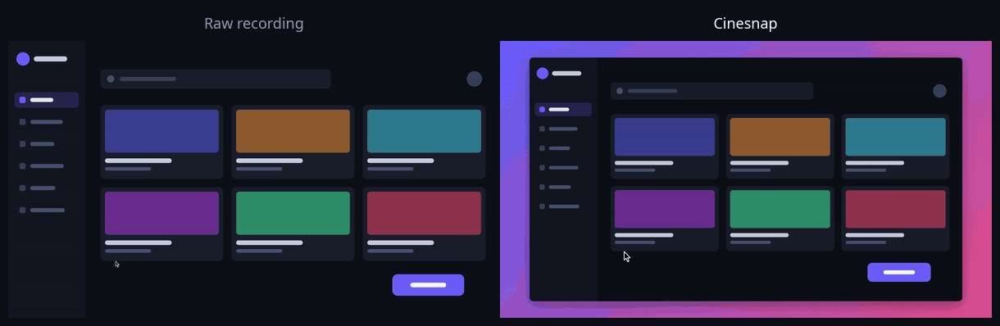
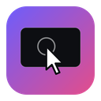
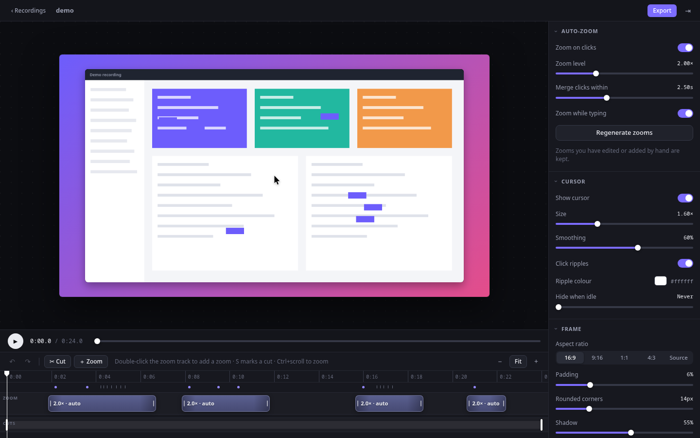
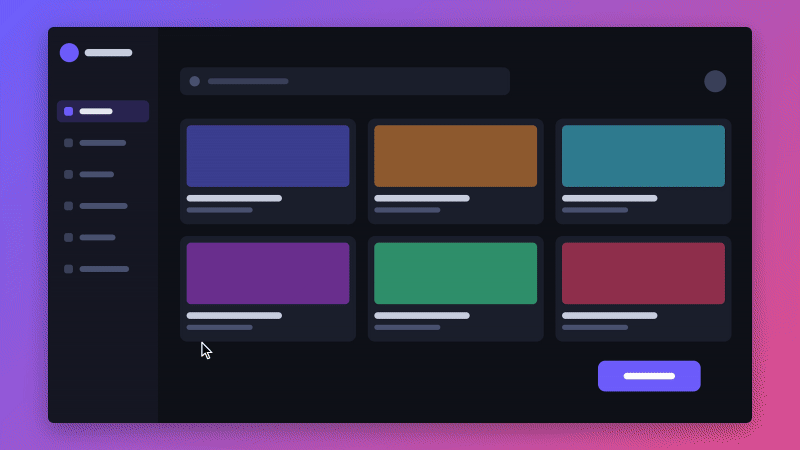

<p align="center">
  <a href="docs/media/before-after.mp4">
    
  </a>
</p>

<p align="center"><sub>The same 12 seconds of screen activity. Left: the raw capture. Right: what Cinesnap exports, with no manual editing. <a href="docs/media/before-after.mp4">Watch as video</a></sub></p>

<h1 align="center">
  <br>
  Cinesnap
</h1>

<p align="center">
  <b>Record your screen. Get a polished demo.</b><br>
  An open-source screen recorder that zooms in where you click, smooths your cursor,<br>
  and frames everything on a clean background — automatically.
</p>

<p align="center">
  <a href="https://github.com/aubergine-ux/cinesnap/actions/workflows/ci.yml"></a>
  <a href="LICENSE"></a>
  
  
</p>

<p align="center">
  <a href="#install">Install</a> ·
  <a href="#how-it-works">How it works</a> ·
  <a href="#platform-support">Platform support</a> ·
  <a href="docs/index.html">Docs</a> ·
  <a href="docs/architecture.md">Architecture</a>
</p>

<br>

## Why

Good product demos zoom in on the thing being clicked, keep the cursor calm and easy to follow, and sit on a tidy background. Making one normally means recording, then spending an hour in a video editor adding keyframes.

Cinesnap records the screen **and** a log of where the cursor was and when you clicked or typed. The video is never touched; the effects are computed from the log. So a first-time user gets a finished video by pressing record and export — and everything stays editable.

<table>
<tr>
<td width="50%" valign="top">

### 🔍 Auto-zoom
Eases in on every click and typing burst and back out again. Clicks close together share one zoom that follows the cursor, so it never feels jumpy.

</td>
<td width="50%" valign="top">

### 🖱️ Cursor polish
The system cursor is left out of the recording. A larger, smoothed one is drawn from the event log, with click ripples — and it still lands exactly on target.

</td>
</tr>
<tr>
<td valign="top">

### 🎞️ Timeline editor
Zooms are blocks you drag, resize, add and delete. Trim the ends, cut out mistakes, tune zoom level and easing per segment. Full undo.

</td>
<td valign="top">

### 🖼️ Framing
Padding, rounded corners and a soft shadow over a gradient, colour, image or blurred wallpaper. 16:9, 9:16 for shorts, 1:1, 4:3.

</td>
</tr>
<tr>
<td valign="top">

### 📦 Export
MP4 (H.264) with hardware encoding where the machine supports it, and small two-pass-palette GIFs sized for READMEs.

</td>
<td valign="top">

### 🎙️ Mic and webcam
Optional microphone track and a webcam bubble in the corner, recorded separately so they can be toggled after the fact.

</td>
</tr>
</table>

<p align="center">
  
</p>

## Install

Grab an installer for your platform from the [**Releases**](https://github.com/aubergine-ux/cinesnap/releases) page:

| Platform | File |
| --- | --- |
| Windows | `.msi` or `.exe` |
| macOS (Apple silicon / Intel) | `.dmg` |
| Linux | `.AppImage`, `.deb` or `.rpm` |

Cinesnap needs **ffmpeg**. If it is not already on your system the app offers to download it on first launch.

<details>
<summary><b>Build from source</b></summary>

<br>

You need [Rust](https://rustup.rs), Node 20+, and the [Tauri prerequisites](https://tauri.app/start/prerequisites/) for your OS. On Linux also install the PipeWire development files (`libpipewire-0.3-dev` / `pipewire`) and `clang`.

```sh
git clone https://github.com/aubergine-ux/cinesnap
cd cinesnap
npm install
npm run tauri dev      # run it
npm run tauri build    # make installers
```

Run the tests with `cargo test --workspace` and `npm test`.

</details>

## Using it

1. **Record** — choose a screen or window (and a mic or webcam if you like) and hit *Start recording*. Cinesnap gets out of the way.
2. **Stop** — bring the window back and press *Stop*. The seconds you spent reaching for the button are trimmed automatically.
3. **Export** — the editor opens with zooms already in place. Tweak if you want, then export an MP4 or GIF.

<p align="center">
  
</p>

| Key | Action |
| --- | --- |
| <kbd>Space</kbd> | Play / pause |
| <kbd>S</kbd> | Mark a cut start, press again to cut to the playhead |
| <kbd>C</kbd> | Drag-to-cut mode |
| <kbd>Delete</kbd> | Remove the selected zoom or cut |
| <kbd>Ctrl</kbd> <kbd>Z</kbd> / <kbd>Ctrl</kbd> <kbd>Shift</kbd> <kbd>Z</kbd> | Undo / redo |
| <kbd>Ctrl</kbd> + scroll | Zoom the timeline |

## How it works

```
 record                          edit                          export
┌───────────────┐   ┌──────────────────────────────┐   ┌─────────────────────┐
│ video.mp4     │   │ project.json                 │   │ ffmpeg decode       │
│ (no cursor)   │──▶│  zooms · cuts · cursor ·     │──▶│  → compositor (Rust)│──▶ MP4 / GIF
│ events.jsonl  │   │  frame · export settings     │   │  → ffmpeg encode    │
│ mic · webcam  │   │ live canvas preview          │   └─────────────────────┘
└───────────────┘   └──────────────────────────────┘
```

- A recording is a folder (`*.cinesnap`) holding the untouched video, an [event log](docs/recording-format.md) of cursor movement, clicks and key activity, and a `project.json` with every edit.
- One motion engine, written in Rust, turns the log into zoom segments, a camera path and a smoothed cursor path. The live preview and the exporter both read its output, so what you see is what you get.
- Only the fact that a key was pressed is logged — never which key.

There is also a CLI for rendering without the app:

```sh
cinesnap-cli render "My demo.cinesnap" -o demo.mp4
cinesnap-cli render "My demo.cinesnap" -o demo.gif
cinesnap-cli render "My demo.cinesnap" -o short.mp4 --aspect 9:16
```

More in [docs/architecture.md](docs/architecture.md).

## Platform support

| | Capture | Cursor position | Clicks and typing |
| --- | --- | --- | --- |
| **Windows 10/11** | Desktop Duplication | ✅ | ✅ |
| **macOS 11+** | AVFoundation | ✅ | ✅ |
| **Linux · X11** | x11grab | ✅ | ✅ |
| **Linux · Wayland** (KDE, GNOME) | ScreenCast portal + PipeWire | ✅ from stream metadata | ✅ with `input` group access, otherwise estimated |
| **Linux · Wayland** (portals without cursor metadata) | ScreenCast portal + PipeWire | ⚠️ cursor stays in the video | ⚠️ timing only |

Wayland deliberately hides global input from applications. Cinesnap reads the cursor position from the screen-sharing stream and button presses from the kernel input devices; for the latter your user needs to be in the `input` group (`sudo usermod -aG input $USER`, then log in again). Without it, clicks are estimated from where the cursor comes to rest. The details and trade-offs are written up in [the architecture notes](docs/architecture.md#wayland-limitations-the-important-part).

> [!NOTE]
> Cinesnap is young. Day-to-day development happens on Linux; the Windows and macOS builds are compiled and unit-tested in CI but have had far less hands-on use. Bug reports from those platforms are especially welcome.

## Contributing

Issues and pull requests are welcome. The codebase is small and split along clear lines:

| Path | What lives there |
| --- | --- |
| `crates/cinesnap-core` | Project format, event log, motion engine, compositor, export, CLI. No GUI dependencies; this is where most logic and tests are. |
| `src-tauri` | The desktop app: capture backends, input tracking, commands. |
| `src` | The TypeScript/React frontend: preview renderer, timeline, settings. |
| `docs` | Architecture, file format, and the docs page. |

## License

[MIT](LICENSE)
