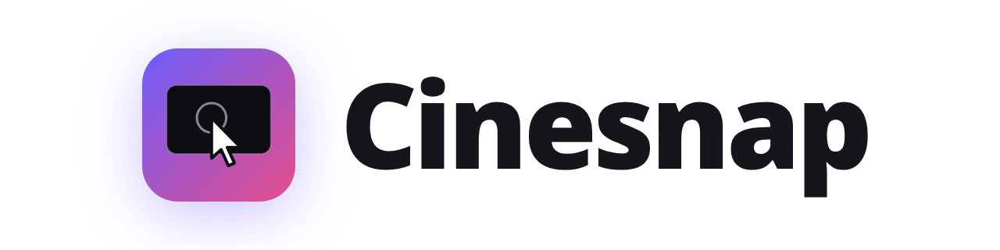
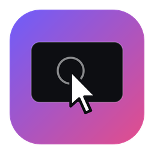

<div align="center">

<a href="https://aubergine-ux.github.io/cinesnap/">
  <picture>
    <source media="(prefers-color-scheme: dark)" srcset="docs/media/banner-dark.png">
    <source media="(prefers-color-scheme: light)" srcset="docs/media/banner-light.png">
    
  </picture>
</a>

### Record your screen. Get a polished demo.

[](https://github.com/aubergine-ux/cinesnap/actions/workflows/ci.yml)
[](https://github.com/aubergine-ux/cinesnap/releases/latest)
[](LICENSE)
[](crates/cinesnap-core)
[](src)
[](#platform-support)

<a href="docs/media/before-after.mp4">
  
</a>

<sub>The same 12 seconds of screen activity. <b>Left:</b> the raw capture. <b>Right:</b> what Cinesnap exports, with no manual editing. <a href="docs/media/before-after.mp4">Watch as video</a></sub>

<br>

[**Download**](https://github.com/aubergine-ux/cinesnap/releases/latest) &nbsp;·&nbsp;
[Features](#features) &nbsp;·&nbsp;
[Install](#install) &nbsp;·&nbsp;
[Usage](#usage) &nbsp;·&nbsp;
[Platform support](#platform-support) &nbsp;·&nbsp;
[Docs](https://aubergine-ux.github.io/cinesnap/)

</div>

<br>

Good product demos zoom in on the thing being clicked, keep the cursor calm and easy to follow, and sit on a tidy background. Making one normally means recording, then an hour in a video editor adding keyframes.

Cinesnap records the screen **and** a log of where the cursor was and when you clicked or typed. The video is never touched; the effects are computed from the log. Press record, press export, and the result already looks edited. Everything stays adjustable afterwards.

## Features

| | | |
| :-- | :-- | :-- |
| 🔍 | **Auto-zoom** | Eases in on every click and typing burst and back out again. Clicks close together share one zoom that follows the cursor. |
| 🖱️ | **Cursor polish** | The system cursor is left out of the recording. A larger, smoothed one is drawn from the log, with click ripples, and still lands exactly on target. |
| 🎞️ | **Timeline editor** | Zooms are blocks you drag, resize, add and delete. Trim the ends, cut out mistakes, tune zoom level and easing per segment. Full undo. |
| 🖼️ | **Framing** | Padding, rounded corners and a soft shadow over a gradient, colour, image or blurred wallpaper. 16:9, 9:16 for shorts, 1:1, 4:3. |
| ✂️ | **Crop** | Record a screen, a window or a region, or pick the region afterwards. Nothing is thrown away, so the crop can always be changed. |
| 🎙️ | **Mic and webcam** | Optional microphone track and a webcam bubble in the corner, recorded separately so they can be toggled later. |
| 📦 | **Export** | MP4 (H.264) with hardware encoding where the machine supports it, and small palette-optimised GIFs sized for READMEs. |
| ⌨️ | **Command line** | Render a recording from a script, or check what a machine supports with `cinesnap doctor`. |

<p align="center">
  
</p>

## Install

Download the installer for your platform from the [**latest release**](https://github.com/aubergine-ux/cinesnap/releases/latest):

| Platform | File |
| :-- | :-- |
| 🪟 Windows 10/11 | `Cinesnap_x.y.z_x64-setup.exe` or `.msi` |
| 🍎 macOS 11+, Apple silicon | `Cinesnap_x.y.z_aarch64.dmg` |
| 🍎 macOS 11+, Intel | `Cinesnap_x.y.z_x64.dmg` |
| 🐧 Linux | `.AppImage`, `.deb` or `.rpm` |

Cinesnap needs **ffmpeg**. If it is not already installed, the start screen offers to download it into Cinesnap's own data folder.

<details>
<summary><b>Build from source</b></summary>

<br>

You need [Rust](https://rustup.rs), Node 20.19+ (or 22.12+), ffmpeg, and the [Tauri prerequisites](https://tauri.app/start/prerequisites/) for your OS.

On Linux, also install the PipeWire development files and clang:

```sh
# Debian / Ubuntu
sudo apt install libpipewire-0.3-dev libclang-dev

# Fedora
sudo dnf install pipewire-devel clang-devel

# Arch
sudo pacman -S pipewire clang
```

Then:

```sh
git clone https://github.com/aubergine-ux/cinesnap
cd cinesnap
npm install
npm run tauri dev      # run the app
npm run tauri build    # build installers into target/release/bundle
```

The AppImage step downloads `linuxdeploy` and is only reliable on Debian and Ubuntu. Elsewhere, build the packages you need:

```sh
npm run tauri build -- --bundles deb,rpm
npm run tauri build -- --no-bundle     # just the binary: target/release/cinesnap
```

Run the tests:

```sh
cargo test --workspace
npm test
```

</details>

## Usage

1. **Record.** Choose a screen or window (and a mic or webcam if you like) and press *Start recording*. Cinesnap gets out of the way.
2. **Stop.** Bring the window back and press *Stop*. The seconds you spent reaching for the button are trimmed for you.
3. **Export.** The editor opens with zooms already in place. Tweak if you want, then export an MP4 or GIF.

<p align="center">
  
</p>

<details>
<summary><b>Keyboard shortcuts</b></summary>

<br>

| Key | Action |
| :-- | :-- |
| <kbd>Space</kbd> | Play / pause |
| <kbd>←</kbd> <kbd>→</kbd> | Step one frame (<kbd>Shift</kbd> for ten) |
| <kbd>S</kbd> | Mark a cut start, press again to cut to the playhead |
| <kbd>C</kbd> | Drag-to-cut mode |
| <kbd>Delete</kbd> | Remove the selected zoom or cut |
| <kbd>Ctrl</kbd> <kbd>Z</kbd> / <kbd>Ctrl</kbd> <kbd>Shift</kbd> <kbd>Z</kbd> | Undo / redo |
| <kbd>Ctrl</kbd> + scroll | Zoom the timeline |
| <kbd>Esc</kbd> | Clear the selection, leave cut mode |

</details>

<details>
<summary><b>Command line</b></summary>

<br>

The app binary doubles as a command-line tool. Recordings are plain folders (`*.cinesnap`) in `Videos/Cinesnap`.

```sh
# render with the settings saved in the recording
cinesnap render "My demo.cinesnap" -o demo.mp4

# a README-sized GIF, and a vertical cut for shorts
cinesnap render "My demo.cinesnap" -o demo.gif
cinesnap render "My demo.cinesnap" -o short.mp4 --aspect 9:16 --preset 1080p

# open a recording straight in the editor
cinesnap "My demo.cinesnap"

# record five seconds without opening the window
cinesnap record out.cinesnap --seconds 5

# what this machine supports: capture, cursor, clicks, encoder, devices
cinesnap doctor
```

| Option | Values |
| :-- | :-- |
| `--preset` | MP4: `4k`, `1440p`, `1080p`, `720p` · GIF: `readme` (800 px wide), `small` (480 px) |
| `--quality` | `low`, `medium`, `high` |
| `--aspect` | `16:9`, `9:16`, `1:1`, `4:3`, any other `W:H`, or `source` |
| `--fps` | 1 to 120 (MP4 only) |
| `--software` | Skip the hardware encoder |

For a machine without a desktop, `cargo build --release -p cinesnap-core` builds the same command line as `cinesnap-cli`, with no GUI dependencies.

</details>

## How it works

```
 record                          edit                          export
┌───────────────┐   ┌──────────────────────────────┐   ┌─────────────────────┐
│ video.mp4     │   │ project.json                 │   │ ffmpeg decode       │
│ (no cursor)   │──▶│  zooms · cuts · cursor ·     │──▶│  → compositor (Rust)│──▶ MP4 / GIF
│ events.jsonl  │   │  frame · export settings     │   │  → ffmpeg encode    │
│ mic · webcam  │   │ live canvas preview          │   └─────────────────────┘
└───────────────┘   └──────────────────────────────┘
```

- A recording is a folder holding the untouched video, an [event log](docs/recording-format.md) of cursor movement, clicks and key activity, and a `project.json` with every edit.
- One motion engine, written in Rust, turns the log into zoom segments, a camera path and a smoothed cursor path. The live preview and the exporter both read its output, so what you see is what you get.
- Only the fact that a key was pressed is logged, never which key.

More in [docs/architecture.md](docs/architecture.md).

## Platform support

| | Capture | Cursor position | Clicks and typing |
| :-- | :-- | :-- | :-- |
| **Windows 10/11** | Desktop Duplication | ✅ | ✅ |
| **macOS 11+** | AVFoundation | ✅ | ✅ |
| **Linux · X11** | x11grab | ✅ | ✅ |
| **Linux · Wayland** (KDE, GNOME) | ScreenCast portal + PipeWire | ✅ from stream metadata | ✅ with `input` group access, otherwise estimated |
| **Linux · Wayland** (portals without cursor metadata) | ScreenCast portal + PipeWire | ⚠️ cursor stays in the video | ⚠️ timing only |

<details>
<summary><b>Wayland and the <code>input</code> group</b></summary>

<br>

Wayland deliberately hides global input from applications. Cinesnap reads the cursor position from the screen-sharing stream and button presses from the kernel input devices. For the latter, your user needs to be in the `input` group:

```sh
sudo usermod -aG input $USER   # then log out and back in
```

Without it, clicks are estimated from where the cursor comes to rest. The trade-offs are written up in [the architecture notes](docs/architecture.md#wayland-limitations-the-important-part).

</details>

> [!NOTE]
> Cinesnap is young. Day-to-day development happens on Linux; the Windows and macOS builds are compiled and unit-tested in CI but have had far less hands-on use. Bug reports from those platforms are especially welcome.

## Contributing

Issues and pull requests are welcome. The codebase is small and split along clear lines:

| Path | What lives there |
| :-- | :-- |
| [`crates/cinesnap-core`](crates/cinesnap-core) | Project format, event log, motion engine, compositor, export, command line. No GUI dependencies; most logic and tests are here. |
| [`src-tauri`](src-tauri) | The desktop app: capture backends, input tracking, commands. |
| [`src`](src) | The TypeScript/React frontend: preview renderer, timeline, settings. |
| [`docs`](docs) | Architecture, file format, and the docs page. |

<br>

<div align="center">



Released under the [MIT License](LICENSE).

Built with [Tauri](https://tauri.app), [ffmpeg](https://ffmpeg.org), [tiny-skia](https://github.com/linebender/tiny-skia) and [PipeWire](https://pipewire.org).

Made by [@aubergine-ux](https://github.com/aubergine-ux)

</div>
